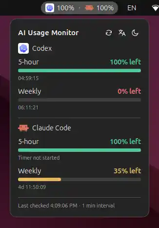

# AI Usage Monitor

[English README](README.md)

> [!NOTE]
> **v0.12 변경 안내:** 상단 우측 아이콘을 가는 선형 SVG로 표시하며, 아이콘으로 테마(라이트↔다크)와 언어(한국어↔영어)를 즉시 전환합니다. 최초에는 시스템 설정을 따르며, 위젯과 시스템 설정이 같아지면 자동으로 연동을 재개합니다. 시스템 언어 변경은 GNOME 재로그인 후 반영됩니다. 수동 새로고침의 30초 제한은 제거되었으며 조회 중에만 중복 요청을 막습니다. 새로고침 시 잔여율과 초기화 시각을 함께 재조회하며, 응답 수신 후 새로운 시각을 기준으로 카운트다운을 갱신합니다. 아래 기존 안내와 다른 부분은 이 최신 안내를 따릅니다.

> GNOME Shell 46 · Ubuntu 24.04 LTS · v0.12

독립적인 비공식 오픈소스 프로젝트이며 OpenAI 또는 Anthropic과 제휴하지 않습니다.

Ubuntu 24.04 / GNOME Shell 46용 상단 패널 확장 프로그램입니다. Codex 5시간·주간, Claude 5시간·주간 잔여율 및 초기화 카운트다운만 표시합니다.

## 실제 사용 화면

<p align="center">
  
</p>

<p align="center"><em>실제 Ubuntu 24.04 사용 화면입니다. 영어 및 다크 모드를 적용한 상태이며, 잔여율과 남은 시간은 촬영 시점의 값입니다.</em></p>

## 시스템 요구사항 및 호환성

| 항목 | 요구사항 및 지원 범위 | 실제 계정 조회 확인 환경 (v0.2 개발 당시) |
| --- | --- | --- |
| 운영체제 | Ubuntu 24.04 LTS (지원 대상) | Ubuntu 24.04 LTS |
| GNOME Shell | 46 | 46.0 |
| Python | 시스템 `/usr/bin/python3` 3.10 이상 | 3.12.3 |
| Codex CLI (선택) | App Server의 `account/rateLimits/read` 지원 필요. 정확한 최소 버전은 확인되지 않았습니다. | 0.165.0 |
| Claude Code CLI (선택) | `get_usage` 지원 버전 2.1.270 이상 (실험적 인터페이스) | 2.1.323 |
| 구독 및 네트워크 | 사용하려는 CLI의 구독 로그인 및 인터넷 연결 | Codex 및 Claude 구독 |
| 기타 | Python 외부 라이브러리 및 GPU는 필요하지 않습니다. | Python 표준 라이브러리 |

- Ubuntu 22.04 (GNOME 42), Ubuntu 24.10 (GNOME 47) 및 그 외 GNOME 버전은 현재 지원하지 않습니다. 다른 Linux 배포판에서 GNOME 46을 사용하더라도 실제 호환성은 검증되지 않았습니다.
- Python 3.10~3.14는 GitHub Actions의 수집기 테스트 대상입니다. 이는 실제 GNOME UI나 실계정 연동을 검증한다는 의미가 아닙니다.
- CLI의 최신 버전이 항상 호환되는 것은 아닙니다. 위 버전은 실제 조회가 확인된 기준이며, 동일 버전이라도 구독 정책·응답 형식 변경에 따라 조회가 실패할 수 있습니다.
- 두 CLI는 선택 사항입니다. 하나만 설치하면 해당 서비스만 표시하며, 둘 다 설치하지 않아도 위젯을 설치할 수 있습니다.

### 설치 전 환경 진단

프로젝트 폴더에서 다음 명령을 실행합니다.

```bash
bash check_environment.sh
```

`PASS`는 해당 검사 통과, `WARN`은 호환성 미검증 또는 버전 주의, `SKIP`은 선택 사항 미설치, `FAIL`은 필수 요구사항 불충족을 의미합니다. 진단은 CLI 버전과 실행 파일 존재 여부만 확인하며, 구독 로그인이나 실제 사용량 조회는 검사하지 않습니다. 인증 파일을 읽거나 수정하지 않습니다.

`install.sh`도 설치 전에 동일한 검사를 실행합니다. GNOME 버전 불일치, 필수 명령 누락 또는 시스템 Python 버전 미달 시 파일 복사 전에 설치를 중단합니다. 다른 배포판이나 선택 CLI의 버전 문제는 경고만 표시합니다.

## 설치

```bash
sudo apt update
sudo apt install -y python3 gnome-shell-extension-manager unzip
gnome-shell --version
command -v codex
command -v claude
codex --version
claude --version
```

### CLI 설치 및 구독 계정 로그인 (필요한 서비스만)

두 CLI를 모두 설치할 필요는 없습니다. 이미 설치되어 로그인한 CLI는 재설치하지 않습니다. 위젯은 데스크톱 앱이나 웹 브라우저가 아니라 실행 가능한 CLI를 탐색합니다.

**Codex CLI** (공식 npm 설치, npm이 준비되어 있어야 합니다):

```bash
npm --version
npm install -g @openai/codex@latest
codex --version
codex login
```

npm이 없다면 [Codex 공식 설치 안내](https://github.com/openai/codex)를 참고합니다. 로그인 시 구독 중인 ChatGPT 계정을 사용합니다. API 키 기반 결제와 구독 한도는 다릅니다.

**Claude Code CLI** (공식 Linux 설치 스크립트):

```bash
sudo apt install -y curl
curl -fsSL https://claude.ai/install.sh | bash
export PATH="$HOME/.local/bin:$PATH"
claude --version
claude auth login
```

[Claude Code 공식 설치 안내](https://code.claude.com/docs/en/setup). `get_usage`를 지원하는 Claude Code 2.1.270 이상이 필요합니다. 구독 중인 Claude 계정으로 로그인합니다.

설치 및 로그인 후 `command -v codex` 또는 `command -v claude`가 실행 경로를 반환하는지 확인합니다. 사용자 지정 경로에서 설치했다면 위젯 소스 폴더에서 `bash install.sh`를 다시 실행하여 PATH를 갱신합니다.

| 설치 상태 | 패널 및 상세 팝업 |
| --- | --- |
| Codex만 설치 | Codex 5시간·주간만 표시 |
| Claude Code만 설치 | Claude 5시간·주간만 표시 |
| 둘 다 설치 | 네 개 모두 표시 |
| 둘 다 미설치 | AI 표시 및 팝업에서만 CLI 설치·로그인 안내 |

설치되지 않은 CLI는 실행하지 않고 오류도 표시하지 않습니다. 설치된 CLI의 실제 조회 실패(로그인 만료, 네트워크 오류 등)는 해당 서비스에 한해 표시합니다. 매 조회 시 설치 여부를 재확인하며, 삭제된 서비스의 이전 캐시도 제거합니다.

압축을 푼 폴더에서 다음 명령을 실행합니다.

```bash
python3 extension/collector.py --demo
bash install.sh
python3 extension/collector.py | python3 -m json.tool
```

로그아웃 후 다시 로그인하여 다음 명령을 실행합니다(또는 Extension Manager의 Installed에서 활성화합니다).

```bash
gnome-extensions enable ai-usage-monitor@local
gnome-extensions info ai-usage-monitor@local
```

패널의 설치된 서비스 제품 아이콘과 잔여량을 클릭하면 해당 상세 항목 및 수동 새로고침을 볼 수 있습니다. 자동 조회는 1분마다, 카운트다운은 1초마다 갱신됩니다. 수동 조회는 이전 조회가 끝난 즉시 다시 실행할 수 있습니다. CLI 조회는 병렬로 수행합니다. 실제 토큰 수가 아니라 구독 한도의 잔여 백분율입니다.

## 업데이트

Git으로 받은 경우에는 먼저 `git pull`로 소스를 업데이트합니다.

```bash
gnome-extensions disable ai-usage-monitor@local
bash install.sh
```

로그아웃 및 재로그인 후 `gnome-extensions enable ai-usage-monitor@local`을 실행합니다.

### ZIP으로 업데이트

기존 사용자는 패키지를 재설치할 필요 없이 새 ZIP을 기존 소스 폴더에 덮어쓰고 `bash install.sh` → 로그아웃/로그인 → `gnome-extensions enable ai-usage-monitor@local` 순서로 진행합니다. 설치 폴더의 아이콘도 자동으로 복사됩니다.

## 테마

팝업 우측 상단 테마 아이콘을 클릭하면 라이트 모드와 다크 모드를 전환합니다. 기본값은 시스템 설정이며, 위젯과 시스템 설정이 같으면 우분투의 색상 모드 변경을 따라갑니다. 선택은 `~/.config/ai-usage-monitor/theme` (XDG_CONFIG_HOME 적용)에 보존됩니다. 상단 패널 자체는 GNOME 기본 테마를 유지합니다. 로고는 로컬 SVG로 포함되며 출처는 `extension/icons/NOTICE.md`에 있습니다.

서버 조회는 60초마다 시도하며, 이전 조회가 진행 중이면 중복 실행하지 않습니다. 수동 조회는 이전 조회가 끝난 즉시 다시 실행할 수 있습니다. 서버 오류/제한 발생 시 기존 캐시 및 오류 표시를 확인합니다.

## UI 데모 모드

설치 후 다음 명령으로 설정을 변경합니다. 실계정 데이터를 조회하지 않습니다.

```bash
python3 - <<'PY'
import os,json,pathlib
p=pathlib.Path(os.environ.get('XDG_CONFIG_HOME',pathlib.Path.home()/'.config'))/'ai-usage-monitor/config.json'
d=json.loads(p.read_text()); d['demo']=True; p.write_text(json.dumps(d,indent=2))
PY
```

이전 조회가 끝난 후 새로고침하거나 확장 프로그램을 껐다가 켭니다. 패널에서 `DEMO`가 표시됩니다. 실사용 전 `True`를 `False`로 변경하여 같은 명령을 실행합니다.

## 파일 구성

```text
ai-usage-monitor/
├── extension/              # GNOME 실행 파일
│   ├── metadata.json
│   ├── extension.js
│   ├── collector.py
│   ├── i18n.js
│   ├── preferences.js
│   ├── stylesheet.css
│   └── icons/
├── tests/                  # 자동 테스트
├── docs/screenshots/       # 실제 사용 화면
├── .github/workflows/
├── install.sh
├── uninstall.sh
├── check_environment.sh
├── README.md
└── README.ko.md
```

`extension/`에는 위젯 실행에 필요한 파일만 모아 두었습니다. 설치·제거·환경 진단 명령은 기존처럼 프로젝트 최상위 폴더에서 실행합니다. 테스트와 스크린샷은 설치 폴더에 복사하지 않습니다.

## 문제 해결

```bash
python3 extension/collector.py | python3 -m json.tool
journalctl --user -b -o cat | grep -iE 'ai-usage-monitor|JS ERROR' | tail -n 50
```

- `errors.codex` / `errors.claude`: 설치된 CLI의 버전·구독 로그인을 점검합니다. 설치 시 기록한 CLI 경로 및 PATH는 `~/.config/ai-usage-monitor/config.json`에서 확인합니다. CLI 이동·업데이트 후 `bash install.sh`를 다시 실행합니다.
- GNOME이 확장을 찾지 못하면 로그아웃 후 재로그인합니다. Wayland에서 Alt+F2의 `r`은 사용하지 않습니다.
- Claude 5시간 응답이 `is_active: false`이고 초기화 시각이 없으면 `타이머 미시작`으로 표시합니다.
- `~` 및 `이전 값`은 조회 실패 시의 캐시입니다. 초기화 예정 시각이 경과한 수치는 숨기고 다음 조회를 기다립니다.
- GNOME UI 갱신: 소스 수정 후 `bash install.sh` → 로그아웃/로그인 → 확장 활성화.

## 개인정보 및 보안

기본 설정 위치: `~/.config/ai-usage-monitor/config.json`; 사용량 캐시: `~/.cache/ai-usage-monitor/usage.json`. XDG 디렉터리가 설정된 환경에서는 이를 따릅니다. 인증 파일을 직접 읽거나 전송하지 않습니다. CLI가 자체 인증을 처리합니다. 모델 생성 요청을 보내지 않습니다. API 키 환경 변수 대신 로컬 구독 로그인을 사용하도록 주요 API 키 변수를 자식 프로세스에서 제외합니다. 사용자 지정 CLI 설정에 따라 인증 방식이 다를 수 있습니다.

## 제거

프로젝트 폴더에서 다음 명령을 실행합니다.

```bash
bash uninstall.sh
```

확장 프로그램만 제거되며 Python, CLI, 구독 로그인 및 위젯 설정과 캐시는 유지됩니다. 위젯 설정과 캐시까지 삭제하려면 다음 명령을 실행합니다(위젯 데이터만 삭제됩니다).

```bash
rm -rf -- "${XDG_CONFIG_HOME:-$HOME/.config}/ai-usage-monitor"
rm -rf -- "${XDG_CACHE_HOME:-$HOME/.cache}/ai-usage-monitor"
```

## 프로토콜 참고

- Codex: https://learn.chatgpt.com/docs/app-server — `initialize` → `initialized` → `account/rateLimits/read`. `usedPercent`, `windowDurationMins`, `resetsAt` 필드를 사용합니다. 정확히 300/10080분인 한도만 선택합니다.
- Claude: https://ccam.dev/en/features/usage/ 및 https://github.com/jhyunwoo/ccam/blob/main/internal/usage/probe.go — 실험적 `get_usage` control request를 사용합니다. `limits` 배열의 `session`, `weekly_all`을 우선 사용하고 `five_hour`, `seven_day`를 호환용으로 파싱합니다. 공식적으로 안정성이 보장되지 않아 향후 수정이 필요할 수 있습니다.
- GNOME: https://gjs.guide/extensions/development/creating.html

## 검증 범위

`python3 -m unittest discover -s tests -p 'test_*.py' -v`로 확인하는 수집기 테스트와 환경 진단 테스트, `bash -n install.sh uninstall.sh` 검사, JS 모듈 구문 검사를 모두 통과했습니다. 이전 v0.4에서 사용자 제공 실제 Claude 응답 구조를 테스트에 반영했습니다. v0.5에서는 환경 진단 테스트 6개 및 Python 3.10~3.14 대상 GitHub Actions 검사를 추가했습니다. CI 최신 결과는 [Actions](https://github.com/cse1598/ai-usage-monitor/actions)에서 확인할 수 있습니다. 실제 GNOME Shell 세션 및 실계정 연동은 별도로 검증해야 합니다.

## 라이선스 및 브랜드

아이콘은 LobeHub Icons의 MIT 라이선스에 따라 포함되며, 원본 라이선스는 `extension/icons/LICENSE`를 참조합니다. 제품명 및 로고는 각 권리자의 자산이며 공식 제휴나 승인을 의미하지 않습니다. 코드의 공개 라이선스는 저장소 소유자가 선택합니다.
