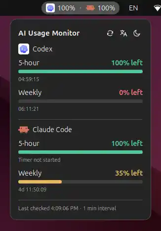

# AI Usage Monitor

> [!NOTE]
> **한국어 사용자이신가요? [한국어 설치 및 사용 안내 바로가기 →](README.ko.md)**

> GNOME Shell 46 · Ubuntu 24.04 LTS · v1.0.0

An independent, unofficial open-source project. Not affiliated with OpenAI or Anthropic.

A lightweight GNOME Shell top-panel extension for Ubuntu 24.04. Monitor Codex and Claude Code subscription quotas (5-hour and weekly) and their reset countdowns. No separate login, API key or external Python packages are required.

## Screenshot

<p align="center">
  
</p>

<p align="center"><em>Actual desktop screenshot (English, dark mode). The percentages and countdowns are captured at one moment in time.</em></p>

## Features

- Monitor Codex and Claude Code 5-hour and weekly subscription quotas and reset countdowns.
- Automatically detect the installed CLI applications; either or both are optional.
- Refresh usage and reset timestamps every minute, or manually as soon as the current query completes.
- Update countdowns every second and display cached values clearly when queries fail.
- Switch between English and Korean, or Light and Dark, using compact header icons.
- Follow the system theme and language by default; automatically resynchronize when the widget and system match.
- Keep usage data and preferences local, with no separate login or external Python dependencies.

## Requirements and compatibility

| Component | Requirement / support | Environment used to verify live account queries (v0.2 development) |
| --- | --- | --- |
| Operating system | Ubuntu 24.04 LTS (supported target) | Ubuntu 24.04 LTS |
| GNOME Shell | 46 | 46.0 |
| Python | System `/usr/bin/python3` 3.10 or later | 3.12.3 |
| Codex CLI (optional) | App Server with `account/rateLimits/read`; exact minimum version is unconfirmed | 0.165.0 |
| Claude Code CLI (optional) | 2.1.270 or later with experimental `get_usage` support | 2.1.323 |
| Subscription and network | Subscription login for the chosen CLI and an internet connection | Codex and Claude subscriptions |
| Other | No external Python packages or GPU required | Python standard library |

- Ubuntu 22.04 (GNOME 42), Ubuntu 24.10 (GNOME 47), and other GNOME versions are not supported. Other Linux distributions with GNOME 46 have not been verified.
- Python 3.10–3.14 are targeted by the collector CI matrix. This does not validate live GNOME UI rendering or account integration.
- Newer CLI versions are not guaranteed to be compatible. Changes in subscription policies or response formats may break queries even on previously tested versions.
- Both CLIs are optional. Only installed services are shown; the extension can also be installed without either CLI.

### Check the environment

From the project directory:

```bash
bash check_environment.sh
```

`PASS` indicates a passed check, `WARN` indicates an unverified environment or version warning, `SKIP` indicates an optional component is missing, and `FAIL` indicates an unmet mandatory requirement. The diagnostics check CLI versions and executable availability, not account login or actual usage. They do not read or modify credential files.

The installer runs the same checks before copying files. An unsupported GNOME version, missing mandatory command, or insufficient system Python version stops installation. Other distributions or optional CLI version issues produce warnings only.

## Installation

Download the repository or clone it:

```bash
git clone https://github.com/cse1598/ai-usage-monitor.git
cd ai-usage-monitor
```

Install dependencies and inspect your environment:

```bash
sudo apt update
sudo apt install -y python3 gnome-shell-extension-manager unzip
gnome-shell --version
command -v codex
command -v claude
codex --version
claude --version
```

A missing optional CLI may report "command not found" in these manual checks. You do not need to install both.

### Install and sign in to your preferred CLI(s)

Existing installed and authenticated CLIs do not need to be reinstalled. The extension detects executable CLI programs, not desktop apps or browser sessions.

**Codex CLI** (official npm installation; npm must be available):

```bash
npm --version
npm install -g @openai/codex@latest
codex --version
codex login
```

If npm is unavailable, refer to the [official Codex installation instructions](https://github.com/openai/codex). Sign in with your subscribed ChatGPT account. API-key billing and subscription quotas are different.

**Claude Code CLI** (official Linux installer):

```bash
sudo apt install -y curl
curl -fsSL https://claude.ai/install.sh | bash
export PATH="$HOME/.local/bin:$PATH"
claude --version
claude auth login
```

See the [official Claude Code setup guide](https://code.claude.com/docs/en/setup). Claude Code 2.1.270 or later with `get_usage` support is required. Sign in with your subscribed Claude account.

After installation and login, verify that `command -v codex` or `command -v claude` returns the executable path. If installed in a custom location, rerun `bash install.sh` from the source directory to update the saved PATH.

| Installed services | Panel and popup |
| --- | --- |
| Codex only | Codex 5-hour and weekly quotas |
| Claude Code only | Claude 5-hour and weekly quotas |
| Both | All four quotas |
| Neither | AI indicator, with CLI installation and login guidance only in the popup |

Missing CLIs are neither launched nor treated as errors. Real query failures from installed CLIs (expired login, network failure, etc.) are displayed for the affected provider. Each poll rechecks CLI availability and removes stale cache entries for deleted providers.

From the extracted or cloned project directory:

```bash
python3 extension/collector.py --demo
bash install.sh
python3 extension/collector.py | python3 -m json.tool
```

Log out and back in, then run the commands below (or enable AI Usage Monitor under Installed in Extension Manager):

```bash
gnome-extensions enable ai-usage-monitor@local
gnome-extensions info ai-usage-monitor@local
```

Click the provider icons and percentages in the top panel to see details and manually refresh. Usage is polled every minute and countdowns update every second. Manual refresh can run again immediately after the previous query finishes. CLI queries run in parallel. Values represent the percentage of subscription quota remaining, not literal token counts.

## Updating

If you cloned the repository, first update the source with `git pull`.

```bash
gnome-extensions disable ai-usage-monitor@local
bash install.sh
```

Log out and back in, then run `gnome-extensions enable ai-usage-monitor@local`.

### Updating from a ZIP

Existing users do not need to reinstall dependencies. Extract the new ZIP into a clean source directory to avoid retaining obsolete files, run `bash install.sh`, log out and back in, then enable the extension again. Existing widget settings and cache are preserved.

## Theme and language

Click the **theme icon** in the top-right corner to toggle Light ↔ Dark. The first launch follows Ubuntu's color scheme. When the widget and system match, the widget follows subsequent system changes. When they differ, the widget preserves its own value until the system matches it again, at which point synchronization is restored automatically. The preference is saved to `~/.config/ai-usage-monitor/theme` (respecting XDG_CONFIG_HOME). The GNOME top panel retains its native theme. The refresh icon manually queries usage. SVG logos are bundled locally; see `extension/icons/NOTICE.md` for attribution.

Click the **language icon** to toggle English ↔ 한국어. The same automatic synchronization rule applies to the effective GNOME session language (Korean for Korean locales, English otherwise). The widget changes immediately on a click; a GNOME session language change normally requires logging out and back in. Saved preferences are reconciled with the current session at startup and whenever the popup opens. The mode is stored in `~/.config/ai-usage-monitor/language` (respecting XDG_CONFIG_HOME).

Usage queries are attempted every 60 seconds, without overlapping a previous query. There is no widget-imposed manual refresh cooldown; only simultaneous requests are blocked. Upstream CLI/server rate limits still apply. Each query requests both usage and reset timestamps; after a successful response, countdowns are recalculated from the returned deadlines even when percentages have not changed. Refreshing does not reset the actual subscription window. Cached data and error messages are displayed when a server request fails.

## UI demo mode

After installation, enable demo mode with the following command. No live account data is queried.

```bash
python3 - <<'PY'
import os,json,pathlib
p=pathlib.Path(os.environ.get('XDG_CONFIG_HOME',pathlib.Path.home()/'.config'))/'ai-usage-monitor/config.json'
d=json.loads(p.read_text()); d['demo']=True; p.write_text(json.dumps(d,indent=2))
PY
```

Refresh after any in-flight query finishes, or disable and re-enable the extension. The panel displays `DEMO`. Before using live data, change `True` to `False` and run the same command.

## Project structure

```text
ai-usage-monitor/
├── extension/                # GNOME runtime package
│   ├── metadata.json
│   ├── extension.js          # Panel and popup
│   ├── collector.py          # CLI usage collection
│   ├── i18n.js               # English/Korean strings
│   ├── preferences.js        # System synchronization
│   ├── stylesheet.css
│   └── icons/                # Active SVG assets and attribution
├── tests/                    # Python and JavaScript tests
├── docs/
│   └── screenshots/          # Actual desktop screenshots
├── .github/workflows/ci.yml   # Compatibility checks
├── install.sh
├── uninstall.sh
├── check_environment.sh
├── README.md                 # English
└── README.ko.md              # Korean
```

Only the runtime files in `extension/` are copied into the GNOME extension directory. The project-level scripts remain in the repository root for convenient installation, updating, and removal. Tests and screenshots are not installed.

## Troubleshooting

```bash
python3 extension/collector.py | python3 -m json.tool
journalctl --user -b -o cat | grep -iE 'ai-usage-monitor|JS ERROR' | tail -n 50
```

- `errors.codex` / `errors.claude`: check the installed CLI versions and subscription login. Saved CLI paths and PATH are in `~/.config/ai-usage-monitor/config.json`. Rerun `bash install.sh` after relocating or updating a CLI.
- If GNOME cannot find the extension, log out and back in. Do not use Alt+F2 followed by `r` under Wayland.
- Claude's 5-hour quota displays "Timer not started" when `is_active: false` and no reset time is returned.
- `~` and "Cached" indicate values retained after a failed query. Values are hidden when their expected reset time has passed until a new query succeeds.
- After changing source code, run `bash install.sh`, log out and back in, and enable the extension.

## Privacy and security

Configuration: `~/.config/ai-usage-monitor/config.json`. Usage cache: `~/.cache/ai-usage-monitor/usage.json`. XDG directories are respected. Credential files are not directly read or transmitted. Each CLI handles its own authentication. No model-generation requests are sent. Major API-key environment variables are removed from the child processes to favor the existing local subscription login. Authentication behavior can differ with custom CLI configurations.

## Uninstallation

From the project directory:

```bash
bash uninstall.sh
```

Only the extension is removed; Python, CLIs, subscription login, extension settings and cache are preserved. To remove extension settings and cache as well (extension data only):

```bash
rm -rf -- "${XDG_CONFIG_HOME:-$HOME/.config}/ai-usage-monitor"
rm -rf -- "${XDG_CACHE_HOME:-$HOME/.cache}/ai-usage-monitor"
```

## Protocol references

- Codex: https://learn.chatgpt.com/docs/app-server — `initialize` → `initialized` → `account/rateLimits/read`. Uses `usedPercent`, `windowDurationMins`, and `resetsAt`; only selects windows of exactly 300/10080 minutes.
- Claude: https://ccam.dev/en/features/usage/ and https://github.com/jhyunwoo/ccam/blob/main/internal/usage/probe.go — experimental `get_usage` control request. Prefers `session` and `weekly_all` in the `limits` array, with `five_hour` and `seven_day` as compatibility fallbacks. This interface is not guaranteed stable.
- GNOME: https://gjs.guide/extensions/development/creating.html

## Testing

```bash
python3 -m unittest discover -s tests -p 'test_*.py' -v
node --test tests/test_i18n.mjs tests/test_preferences.mjs
for script in install.sh uninstall.sh check_environment.sh; do
    bash -n "$script" || exit 1
done
node --input-type=module --check < extension/extension.js
node --input-type=module --check < extension/i18n.js
node --input-type=module --check < extension/preferences.js
```

The 11 collector tests and 6 environment tests are included alongside the localization tests. See [GitHub Actions](https://github.com/cse1598/ai-usage-monitor/actions) for CI results. Actual GNOME rendering and live account integration require separate verification.

## License and trademarks

Icons are included under the LobeHub Icons MIT license; see `extension/icons/LICENSE`. Product names and logos belong to their respective rights holders and do not imply affiliation or endorsement. The repository owner selects the license for the project's code.
